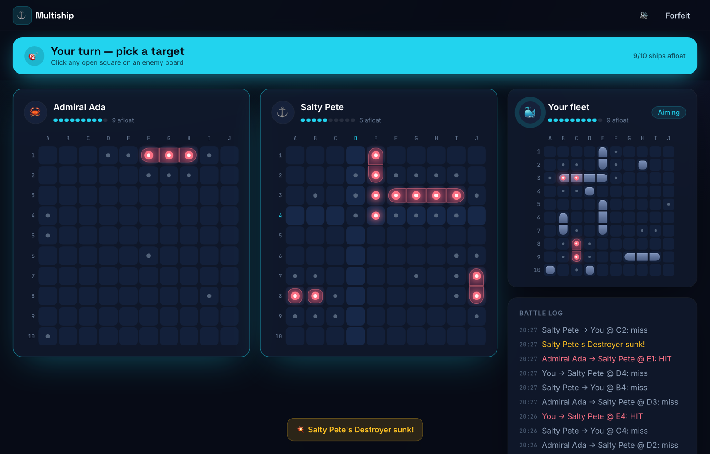
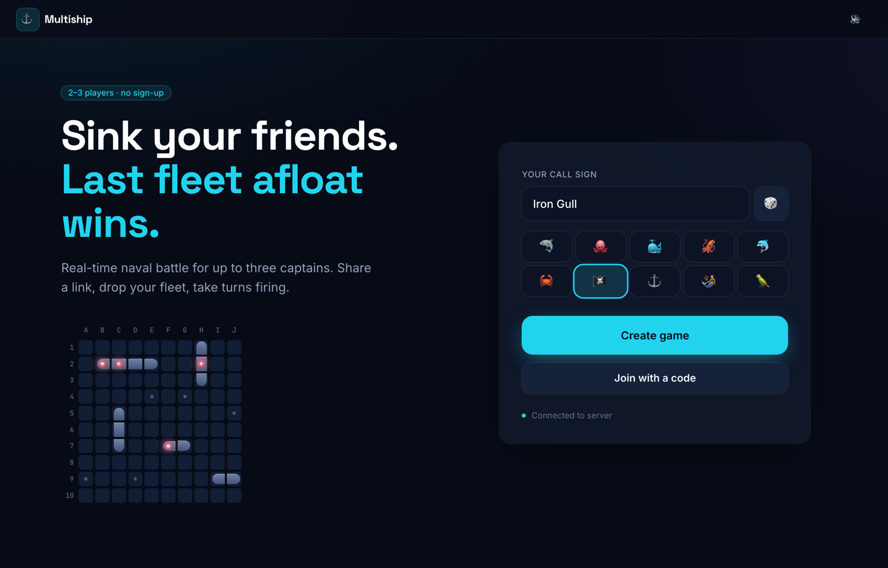
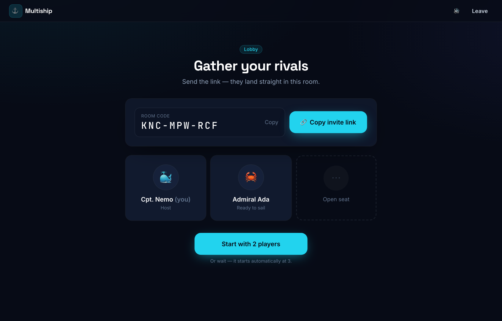
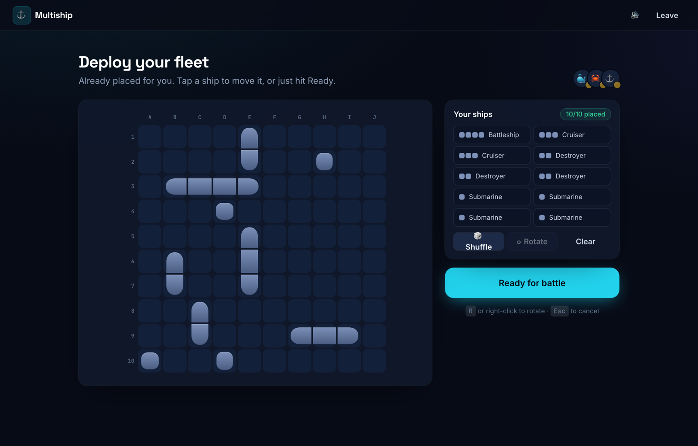
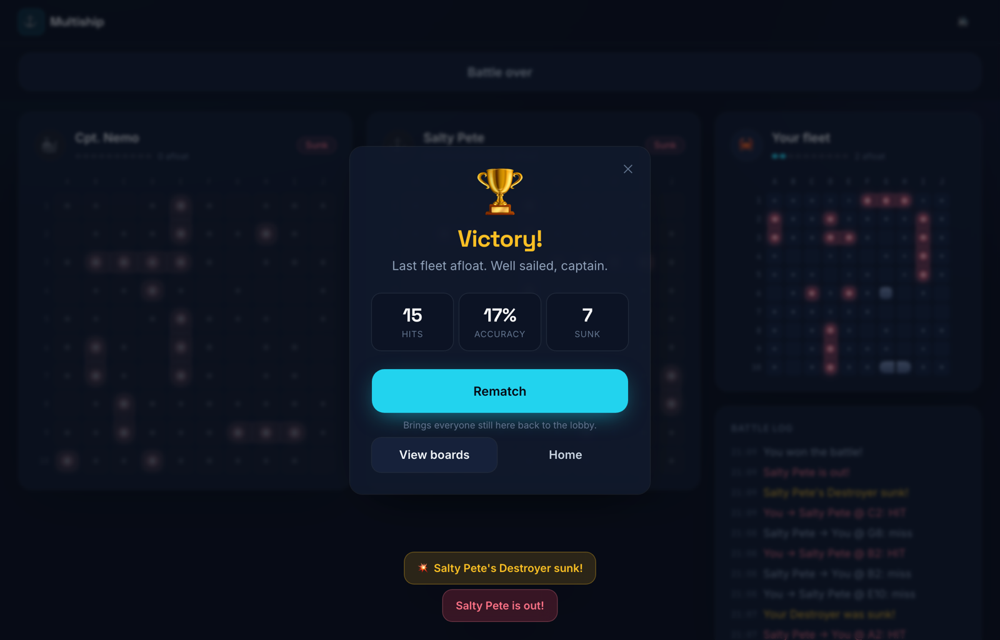
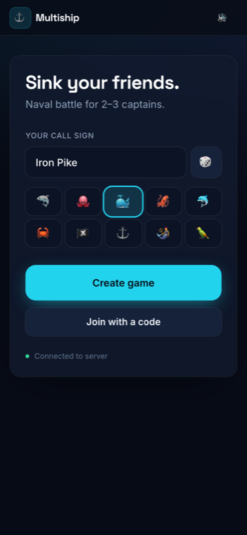
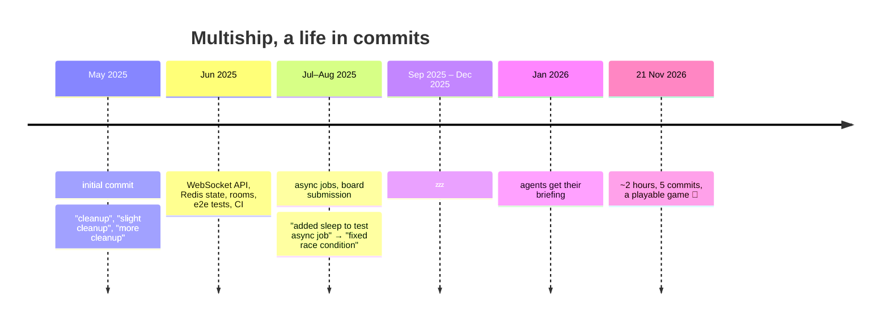
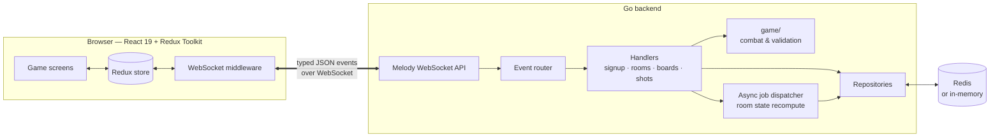

<div align="center">

# ⚓ Multiship

### Sink your friends. Last fleet afloat wins.

Real-time, browser-based naval battle for **2–3 captains**.<br/>
Share a link, drop your fleet, take turns firing. No sign-up, no install.

**[▶ Play now at shuvojit.dev/multiship](https://shuvojit.dev/multiship)**

[](https://github.com/sarkarshuvojit/multiship/actions/workflows/main.yml)
[](https://github.com/sarkarshuvojit/multiship/actions/workflows/ui-build-and-deploy.yml)


<br/>



</div>

---

## 🎮 How it plays

<table>
  <tr>
    <td width="50%" valign="top">
      
      <p align="center"><b>1 · Pick a call sign</b><br/><sub>Random name, emoji avatar, done. No accounts.</sub></p>
    </td>
    <td width="50%" valign="top">
      
      <p align="center"><b>2 · Gather your rivals</b><br/><sub>Send the invite link — friends land straight in your room.</sub></p>
    </td>
  </tr>
  <tr>
    <td width="50%" valign="top">
      
      <p align="center"><b>3 · Deploy your fleet</b><br/><sub>Already shuffled for you. Tap to move, <kbd>R</kbd> to rotate, or just hit Ready.</sub></p>
    </td>
    <td width="50%" valign="top">
      
      <p align="center"><b>4 · Be the last one floating</b><br/><sub>Stats, bragging rights, and a one-click rematch.</sub></p>
    </td>
  </tr>
</table>



### The rules

- **10 × 10 grid**, fleet of **10 ships**: 1 Battleship (4), 2 Cruisers (3), 3 Destroyers (2), 4 Submarines (1).
- Players take turns. On your turn, fire at **any** opponent's board.
- Sink every ship of a captain and they're **eliminated**.
- Last fleet afloat wins. Hit **Rematch** to bring the whole room back to the lobby.

### The nice bits

- 🔗 **Invite links** — `/#/join/abc-def-ghi` drops a friend right into your room
- ⚡ **Real-time** over WebSockets — every shot, sink and elimination is pushed live
- 🔊 **Sound effects** and a 🎯 tab-title ping when it's your turn (mutable, of course)
- 📜 **Battle log** + toasts for sunk ships and knocked-out players
- 🏳️ **Forfeit / leave** at any time without breaking the game for others
- 📱 **Works on phones** — same game, thumb-sized

<br clear="right"/>

---

## 📖 The story: 105 commits by hand, then two hours with an AI

> *A cautionary tale, told by the git log.*

**May 14, 2025.** `initial commit`. A fresh Go module, a fresh React app, a fresh dream: multiplayer Battleship, built properly. Event-driven WebSockets. Redis. Async jobs. End-to-end tests. The works.

What followed was three months of honest, artisanal, hand-typed commits. Some highlights from the archive:

```text
e41ab15  cleanup
1bdcf7b  slight cleanup
ca1db5d  more cleanup
3611b50  fixed imports
6ade339  fixed import errors
dc3343d  fixed tests
0b22af1  fixed tests and doing len based testing
0350ff8  added sleep to test async job
723a1be  fixed race condition            ← nine minutes later
```

By **August 17, 2025** there were **105 hand-written commits**, a WebSocket API, Redis state, a background job system, a board validator, a test case generator, CI, and a GitHub Pages deploy.

There was not, however, a game you could actually *play*. You could sign up, create a room, join a room, and submit a board. And then… stare at it. The README proudly said **"Work in Progress"**.

Then life happened. The repo slept for five months.

**January 2026.** A brief stirring: `added agents definition`, `added pm agent`. The robots were being *briefed*.

**November 21, 2026, a little after 2 AM.** An AI agent was handed the repo and the existing foundation. About **two hours** later:

| | |
|---|---|
| ⏱️ **Time** | ~2 hours |
| 🧾 **Commits** | 5 |
| 📁 **Files touched** | 89 |
| ➕ **Lines added** | ~4,800 |
| 🎯 **Result** | Combat, turns, sinking, elimination, game over, forfeits, rematch, a full UI redesign — and a game you can actually play |

```text
7b8d50a  feat: add combat logic, gameplay handlers and retroui components
1f65edb  feat(backend): complete game lifecycle
c06428d  feat(ui): wire pages to the websocket for a playable game
6dcf9c2  feat(backend): add REMATCH to replay a finished room
2fc69e5  feat(ui): redesign the game for a modern, low-friction flow
```



**The moral?** Honestly, it's not "humans are obsolete". The two hours only worked because the 105 commits were there: the event system, the state layer, the job runner, and the e2e harness were the rails the AI ran on. Somebody had to lay the track. It's just a little humbling when the train shows up and finishes the journey before your coffee gets cold. ☕

---

## 🏗️ Architecture



| | Backend — [`multiship-backend/`](multiship-backend) | Frontend — [`multiship-ui/`](multiship-ui) |
|---|---|---|
| **Language** | Go 1.24 | TypeScript + React 19 |
| **Transport** | [Melody](https://github.com/olahol/melody) (gorilla/websocket) | Custom Redux middleware |
| **State** | Redis, with an in-memory backend | Redux Toolkit |
| **Styling** | — | TailwindCSS 4 |
| **Build** | `go run` / `air` | Vite |
| **Tests** | Unit + end-to-end WebSocket tests | Storybook + Vitest |
| **Hosting** | Render | GitHub Pages → [shuvojit.dev/multiship](https://shuvojit.dev/multiship) |

### Event protocol

Everything is a typed event, defined in Go structs and mirrored in TypeScript.

| Client → Server | Server → Client |
|---|---|
| `SIGN_UP` | `WELCOME` · `SIGNED_UP` · `LIVE_USERS_UPDATED` |
| `CREATE_ROOM` · `JOIN_ROOM` · `LEAVE_ROOM` | `ROOM_CREATED` · `ROOM_JOINED` · `ROOM_LEFT` · `ROOM_STATE` |
| `START_GAME` · `SUBMIT_BOARD` | `BOARD_SUBMITTED` · `BOARD_UPDATED` |
| `TRY_HIT` | `HIT_ATTEMPTED` · `HIT_FAILED` · `SHIP_SUNK` · `NEXT_TURN` |
| `REMATCH` | `PLAYER_ELIMINATED` · `GAME_OVER` · `GENERAL_ERROR` |

---

## 🚀 Run it locally

**Prerequisites:** Go 1.24+, Node + Yarn, and Docker (for Redis — optional).

```bash
# 1. Backend
cd multiship-backend
docker-compose up -d          # Redis on :6379
make serve                    # API on :5000
```

No Docker? Skip Redis entirely:

```bash
STATE_BACKEND=memory make serve
```

```bash
# 2. Frontend (in another terminal)
cd multiship-ui
yarn install
yarn dev
```

Open the printed URL in two or three browser windows and battle yourself.

> **macOS tip:** AirPlay Receiver squats on port 5000. Run the backend with `PORT=5055` and the UI with `VITE_API_URL=ws://localhost:5055/ws yarn dev`.

### Commands

| Backend | | Frontend | |
|---|---|---|---|
| `make serve` | Start the server | `yarn dev` | Dev server |
| `make test` | Run all tests | `yarn build` | Type-check + production build |
| `make testv` | Tests, verbose | `yarn lint` | ESLint |
| `make testw` | Tests in watch mode (`air`) | `yarn preview` | Preview the build |

### Configuration

| Variable | Default | |
|---|---|---|
| `PORT` | `5000` | HTTP / WebSocket port |
| `STATE_BACKEND` | `redis` | `memory` to run without Redis |
| `REDIS_URL` | `localhost:6379` | |
| `REDIS_USERNAME` | *(empty)* | |
| `REDIS_PASSWORD` | `localpass` | |
| `REDIS_USE_TLS` | `NO` | |
| `VITE_API_URL` *(UI)* | `ws://localhost:5000/ws` | WebSocket endpoint the UI connects to |

---

## 🗂️ Project layout

```text
multiship/
├── multiship-backend/
│   ├── cmd/serve/              # entry point
│   ├── internal/api/
│   │   ├── events/             # typed inbound/outbound events
│   │   ├── handlers/           # signup, rooms, boards, gameplay
│   │   ├── jobs/               # async room-state recompute
│   │   └── state/              # Redis + in-memory backends
│   ├── internal/game/          # board validation & combat rules
│   └── e2e/                    # full WebSocket game tests
└── multiship-ui/
    └── src/
        ├── game/               # screens, board, sounds, toasts
        ├── features/           # Redux slices
        ├── ws/                 # WebSocket client + middleware
        └── types/              # event & game types
```

---

## 🧪 Testing

The backend ships with end-to-end tests that spin up a real server and drive it with WebSocket clients: signups, live user counts, three-player rooms, room limits, board submission, a **complete game**, turn validation, invalid shots, and forfeits.

```bash
cd multiship-backend && make test
```

---

<div align="center">

Built by hand, finished with a little help. ⚓<br/>
**[Come sink some ships →](https://shuvojit.dev/multiship)**

</div>
